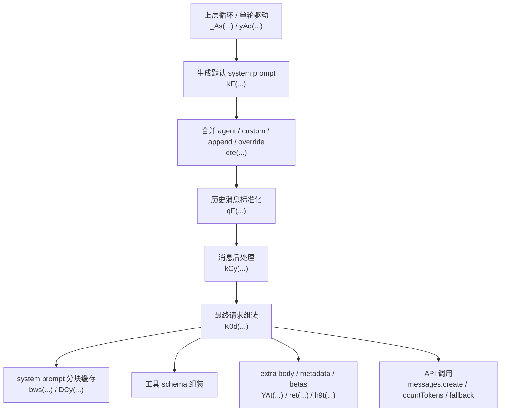

# Claude Code 当前版本系统上下文组装调用流程

日期：2026-07-13  
版本：2.1.204

分析范围：
- 主 bundle：[claude.js](/Users/luyiren/unbuned/output/claude/claude.js:1)
- 关键拆分模块：
  - [resplit/2986.js](/Users/luyiren/unbuned/output/claude/resplit/2986.js:67)
  - [resplit/4205.js](/Users/luyiren/unbuned/output/claude/resplit/4205.js:2)
  - [resplit/4617.js](/Users/luyiren/unbuned/output/claude/resplit/4617.js:2)
  - [resplit/4662.js](/Users/luyiren/unbuned/output/claude/resplit/4662.js:9)
  - [resplit/4647.js](/Users/luyiren/unbuned/output/claude/resplit/4647.js:2)
  - [resplit/5395.js](/Users/luyiren/unbuned/output/claude/resplit/5395.js:8)
  - [resplit/3312.js](/Users/luyiren/unbuned/output/claude/resplit/3312.js:2)

---

## 1. 这份文档在回答什么

这里的“系统上下文组装”，不是单指一个 `system prompt` 字符串，而是 Claude Code 在一次模型调用前，如何把以下几类内容组合成最终请求：

- 顶层 system prompt
- 环境说明
- agent / coordinator 专用提示
- 用户自定义系统提示
- 追加提示
- 记忆、附件、MCP 指令、计划模式、auto mode 等额外上下文
- 历史消息标准化结果
- 工具 schema
- 请求体附加字段（如 extra body / beta / cache / thinking / output config）

也就是说，这里关注的是：

> **Claude Code 从“内部状态”到“最终发给模型的 request payload” 的完整路径。**

---

## 2. 总体调用图



补充：

- 在真正进入 `K0d(...)` 之前，还会先做：
  - 记忆抽取触发
  - brief 模式补丁
  - structured output 强制补丁
  - stop / task / teammate hooks
  - attachment 生成

所以更准确的顺序是：

```text
_As / yAd
  -> 预处理/补丁/钩子
  -> kF
  -> dte
  -> qF
  -> kCy
  -> K0d
  -> messages.create
```

---

## 3. 第一层：每轮调用入口

### 3.1 `_As(...)` 与 `yAd(...)`

关键位置：

- [resplit/4617.js](/Users/luyiren/unbuned/output/claude/resplit/4617.js:2)

这两个是非常重要的上层入口。

可以把它们理解成：

- `_As(...)`：更偏“回合收尾/继续前”的包装层
- `yAd(...)`：更偏“下一轮真正送模型前”的包装层

它们的共同特征是：

- 都接收已经存在的消息片段
- 都持有：
  - `systemPrompt`
  - `userContext`
  - `systemContext`
  - `toolUseContext`
  - `querySource`
  - `stickyBetas`

也就是说，在它们这一层，系统上下文已经不是一个字符串，而是一个结构体。

### 3.2 Cache-safe 参数缓存

在 `repl_main_thread` 或 `sdk` 场景下：

- `_As(...)` 和 `yAd(...)` 都会调用：
  - `Oho(VPe(...))`

证据：

- [resplit/4617.js](/Users/luyiren/unbuned/output/claude/resplit/4617.js:2)
- [claude.js](/Users/luyiren/unbuned/output/claude/claude.js:1) 中对应实现：
  - `Oho(...)`
  - `VPe(...)`

`VPe(...)` 会缓存：

- `systemPrompt`
- `userContext`
- `systemContext`
- `toolUseContext`
- `forkContextMessages`
- `stickyBetas`

这个缓存后续会被用于：

- fork / subagent
- compact
- 某些 cache-safe / replay / context hint 场景

这是一条很关键的特殊分支：

> **CLI 主线程和 SDK 模式，会额外保留一份“可安全复用的上下文快照”。**

---

## 4. 第二层：在发请求前插入补丁、钩子和强制提醒

### 4.1 记忆抽取触发

在 `yAd(...)` 中：

- 非 agent 场景
- 且满足条件时

会调用：

- `iEy.executeExtractMemories(...)`
- `MCd(...)`

位置：

- [resplit/4617.js](/Users/luyiren/unbuned/output/claude/resplit/4617.js:2)

这意味着在真正发请求之前，Claude Code 可能会先：

- 预取记忆
- 把记忆相关内容追加进上下文

### 4.2 Brief 模式强制提醒

同样在 `yAd(...)` 中，如果：

- `querySource` 是 `repl_main_thread` 或 `sdk`
- brief 模式开启
- 当前 turn 还没调用过 Brief 工具

会插入一条 `isMeta` 的用户消息：

- `BRIEF_ENFORCE_SENTINEL ...`

位置：

- [resplit/4617.js](/Users/luyiren/unbuned/output/claude/resplit/4617.js:2)

这条消息会作为上下文补丁进入后续消息流。

### 4.3 Structured output 强制提醒

如果：

- `toolUseContext.options.requiresStructuredOutput === true`
- 且当前不是 auxiliary query
- 且还没有调用目标工具

则会插入：

- `You MUST call the ${oh} tool to complete this request.`

位置：

- [resplit/4617.js](/Users/luyiren/unbuned/output/claude/resplit/4617.js:2)

这说明：

> structured output 在当前版本不是只靠 API 参数保证，**还会在上下文层再塞一条强制提醒**。

### 4.4 Goal / Stop hook 特殊处理

`yAd(...)` 里还有一段特殊逻辑：

- 如果 active goal 在跑
- 且后台还有 agent/task/workflow 未完成

则会暂缓某些 goal/stop hook 的收束判断。

位置：

- [resplit/4617.js](/Users/luyiren/unbuned/output/claude/resplit/4617.js:2)
- 关联 goal 逻辑：
  - [resplit/4600.js](/Users/luyiren/unbuned/output/claude/resplit/4600.js:2)

这说明 system context 组装并不是静态拼接，它会受当前会话控制流影响。

### 4.5 Hook 执行结果也会回灌上下文

在 `_As(...)` / `yAd(...)` 中，`j5e(...)` 返回的 hook 结果可能会产生：

- `hook_non_blocking_error`
- `hook_error_during_execution`
- `hook_success`
- `hook_additional_context`
- `hook_stopped_continuation`

这些都会变成 attachment 或 meta message 回灌到消息流。

位置：

- [resplit/4617.js](/Users/luyiren/unbuned/output/claude/resplit/4617.js:2)

这也是一条很重要的特殊分支：

> **外部 hook 的输出，本身就是 system context 的组成部分。**

---

## 5. 第三层：生成默认 system prompt

### 5.1 `kF(...)`

关键位置：

- [resplit/2986.js](/Users/luyiren/unbuned/output/claude/resplit/2986.js:67)

`kF(...)` 是默认 system prompt 的主构造器。

返回值不是单段文本，而是一个 **prompt block 数组**，最后再由 `ju(...)` 统一包装。

### 5.2 极简模式分支

如果 `XBi()` 为真，则直接走最简分支：

- 有 `excludeDynamicSections` 时返回空
- 否则只返回：
  - `CWD`
  - `Date`

这意味着：

> 在某些简化模式/降级模式下，system prompt 可以被压缩到非常小。

### 5.3 标准模式下的主要 section

从 `kF(...)` 当前实现看，system prompt 主要由一串 `H1(...)` section 组成，典型包括：

- `anti_verbosity`
- `action_caution`
- `task_continuity`
- `fable_identity`
- `tool_param_json`
- `investigate_first`
- `session_guidance`
- `memory`
- `env_info_simple` 或 `env_info_static`
- `language`
- `output_style`
- `bg-session`
- `scratchpad`
- `context_management`
- `brief`
- `focus_mode`
- `reproduce_verify_workflow`
- `act_dont_rederive`
- `autonomy_append`
- `attachments token reminder`

位置：

- [resplit/2986.js](/Users/luyiren/unbuned/output/claude/resplit/2986.js:67)

### 5.4 `excludeDynamicSections` 特殊分支

当 `excludeDynamicSections===true` 时：

- 不再注入动态环境/记忆类部分
- 会改走 `env_info_static`

这说明：

> Claude Code 内部是明确区分“可缓存/稳定”上下文和“动态/临时”上下文的。

### 5.5 环境信息 section

`kF(...)` 会调用：

- `YWh(...)`
- `JWh(...)`
- `XWh(...)`

这些函数会拼接：

- 工作目录
- 是否 git repo / git worktree
- 平台
- OS 版本
- shell 信息
- 模型 display name / exact model ID
- knowledge cutoff
- Claude Code 可用入口说明
- Fast mode 说明

证据：

- [resplit/2986.js](/Users/luyiren/unbuned/output/claude/resplit/2986.js:67)

所以“系统上下文”里并不只是一段人格提示，它很大一部分是运行环境说明。

---

## 6. 第四层：合并 main-thread agent / custom / append / override

### 6.1 `dte(...)`

关键位置：

- [resplit/4205.js](/Users/luyiren/unbuned/output/claude/resplit/4205.js:2)

`dte(...)` 是“最终 system prompt 合并器”。

它接收：

- `mainThreadAgentDefinition`
- `toolUseContext`
- `customSystemPrompt`
- `defaultSystemPrompt`
- `appendSystemPrompt`
- `overrideSystemPrompt`

### 6.2 优先级规则

#### 分支 1：`overrideSystemPrompt`

如果有 `overrideSystemPrompt`：

- 直接 `return ju([override])`

这是最高优先级，直接覆盖。

#### 分支 2：coordinator 模式

如果：

- `ek() === true`
- 且没有 mainThreadAgentDefinition

则使用：

- `getCoordinatorSystemPrompt(...)`

还会把：

- `hasCommsRoledServer(t.options.mcpClients)`

带进去决定 coordinator 提示的内容。

这说明 coordinator 会生成一套独立的系统上下文。

#### 分支 3：main thread agent

如果存在 `mainThreadAgentDefinition`：

- built-in agent：`getSystemPrompt({ toolUseContext: { options: ... } })`
- custom/non-built-in agent：`getSystemPrompt()`

如果 agent 带 `memory`：

- 还会记录 `tengu_agent_memory_loaded`

#### 分支 4：agent append prompt

如果 agent system prompt 存在，且 `agent.appendSystemPrompt === true`：

- 结果是：
  - `customSystemPrompt / defaultSystemPrompt`
  - 再追加 agent prompt
  - 再追加 `appendSystemPrompt`

#### 分支 5：普通合并

否则：

- 优先 `agent system prompt`
- 否则 `customSystemPrompt`
- 否则 `defaultSystemPrompt`
- 最后再接 `appendSystemPrompt`

### 6.3 这一层的意义

`kF(...)` 负责生成“官方默认 prompt 块”，  
`dte(...)` 负责把它和：

- 主线程 agent
- coordinator
- 用户自定义系统提示
- 额外追加提示

合并成真正要发给模型的 `systemPrompt` 数组。

---

## 7. 第五层：附件系统生成额外上下文

### 7.1 `exd(...)` 是附件总入口

关键位置：

- [resplit/4662.js](/Users/luyiren/unbuned/output/claude/resplit/4662.js:9)

`exd(...)` 会统一收集附件型上下文。

### 7.2 直接短路条件

如果满足任一条件：

- `CLAUDE_CODE_DISABLE_ATTACHMENTS`
- `CLAUDE_CODE_SIMPLE`
- `toolUseContext.options.bareFork`

则只保留极少量附件：

- `queued_commands`
- `agent_listing_delta`

### 7.3 常规附件来源

`exd(...)` 目前会尝试收集的内容很多，包括：

- `at_mentioned_files`
- `mcp_resources`
- `agent_mentions`
- `queued_commands`
- `date_change`
- `ultrathink_effort`
- `deferred_tools_delta`
- `agent_listing_delta`
- `mcp_instructions_delta`
- `changed_files`
- `nested_memory`
- `dynamic_skill`
- `skill_listing`
- `plan_mode`
- `plan_mode_exit`
- `auto_mode`
- `auto_mode_exit`
- `todo_reminders`
- `tool_search_usage_reminder`
- `teammate_mailbox`
- `team_context`
- `agent_pending_messages`
- `critical_system_reminder`
- `total_tokens_reminder`
- `ide_selection`
- `ide_opened_file`
- `output_style`
- `diagnostics`
- `lsp_diagnostics`
- `unified_tasks`
- `async_hook_responses`
- `memory_update`
- `token_usage`
- `budget_usd`
- `output_token_usage`

这已经说明：

> Claude Code 的“系统上下文”有很大一部分其实是 attachment/message 形式的动态注入，而不是都塞进主 system prompt。

### 7.4 `nkt(...)`：把附件变成消息流

关键位置：

- [resplit/4662.js](/Users/luyiren/unbuned/output/claude/resplit/4662.js:17)

`nkt(...)` 的作用是：

1. 调 `exd(...)` 得到 attachment 对象列表
2. 记录 `tengu_attachments`
3. 把 attachment 通过 `ma(...)` 包装成统一消息对象
4. yield 回上层消息流

所以：

> `exd(...)` 是生成器，`nkt(...)` 是真正把附件塞进会话消息流的落点。

### 7.5 `wgo(...)`：attachment 转实际 message content

关键位置：

- [resplit/5395.js](/Users/luyiren/unbuned/output/claude/resplit/5395.js:113)

`wgo(...)` 会把不同 attachment type 转成最终给模型看的文本/结构块。

例如：

- `team_context`
- `relevant_memories`
- `queued_command`
- `diagnostics`
- `plan_mode`
- `auto_mode`
- `mcp_instructions_delta`
- `agent_listing_delta`
- `memory_update`

很多都会变成：

- `<system-reminder> ... </system-reminder>`
- 或 `isMeta` 的用户消息

这一步是理解“为什么 attachment 最后也成了系统上下文”的关键。

---

## 8. 第六层：历史消息标准化

### 8.1 `qF(...)`

关键位置：

- [resplit/5395.js](/Users/luyiren/unbuned/output/claude/resplit/5395.js:8)

`qF(...)` 是真正把内部消息列表转换成模型请求 `messages` 的核心函数之一。

它会做很多事：

### 8.2 重要行为

#### A. 处理 attachment

- 会调用 `wgo(...)`
- 把 attachment 展开成真正的 user/meta message

#### B. 处理 tool references / media 清洗

- 在某些模式下会把 tool reference 去掉
- 会把不兼容的 media 内容替换成说明文本

#### C. 合并相邻 user/system 消息

- 会合并相邻的 `user`
- 也会把某些 `system` 合并进 user/meta carrier

#### D. 处理 assistant content

- 合并同一个 assistant message id 的多段内容
- 对 tool use 顺序做整理
- 清掉纯 thinking / 空白 assistant block

#### E. 修复 tool_use / tool_result 配对

- 会尝试修复缺失的 `tool_result`
- 在某些情况下插入占位文本

#### F. 处理 API/system/error 辅助消息

- 会过滤或降级某些只用于内部控制的消息

总结一句：

> `qF(...)` 不是简单序列化，它是在做一轮“面向模型的消息净化与重排”。

---

## 9. 第七层：消息后处理与最终请求参数预组装

### 9.1 `kCy(...)`

关键位置：

- [resplit/5395.js](/Users/luyiren/unbuned/output/claude/resplit/5395.js:8)

`kCy(...)` 接收：

- 原始内部消息列表
- 工具列表
- 当前模型 / bodyModel
- beta 配置
- tool search 模式

它会输出：

- `messagesPreNormalize`
- `messagesForAPI`
- `midConvFallback`

### 9.2 主要职责

- 先做 `J0d(...)` 一类预清洗
- 调 `qF(...)`
- 再做 `Q0d(...)` / `Iws(...)` / `CCy(...)` 等额外清洗
- 应用 media byte cap
- 处理 tool_search / advisor / mid-conversation fallback 等逻辑

所以 `kCy(...)` 是：

> **“把消息变成真正能送进 API 的 messages” 的最后一道整理层。**

---

## 10. 第八层：最终请求组装

### 10.1 `K0d(...)`

关键位置：

- [resplit/5395.js](/Users/luyiren/unbuned/output/claude/resplit/5395.js:8)

这是主请求构造器。

它会负责：

- 模型 gate / off-switch
- tool schema 组装
- message normalization
- system prompt 拼接
- prompt caching
- beta 注入
- extra body / metadata
- 最终调用 `messages.create`

### 10.2 组装顺序

可以概括成：

1. 校验模型是否被 block
2. 计算 fallback / bodyModel
3. 计算工具 schema、tool search 是否开启
4. 调 `kCy(...)` 得到 `messagesForAPI`
5. 调 `dte(...)` 得到合并后的 system prompt
6. 在 system prompt 前面再加头部片段：
   - `AIn(...)`
   - `Jjn(...)`
7. 再按 cache 规则切块：
   - `bws(...)`
   - `DCy(...)`
8. 合并：
   - `extraToolSchemas`
   - advisor tool schema（如有）
9. 注入：
   - betas
   - thinking
   - output format
   - metadata
   - extra body
10. 调 API

### 10.3 `AIn(...)`：attribution/system header 片段

关键位置：

- [claude.js](/Users/luyiren/unbuned/output/claude/claude.js:1)

`AIn(...)` 会生成一段特殊 header 风格文本，例如：

- `x-anthropic-billing-header: cc_version=...; cc_entrypoint=...; ...`

还会带：

- `entrypoint`
- `workload`
- `is_subagent`
- `cc_prev_req`

但如果设置了：

- `CLAUDE_CODE_ATTRIBUTION_HEADER`

则直接返回空字符串。

这说明：

> 最终 system prompt 不只是自然语言说明，还可能带一段“机器可读风格”的 attribution 头。

### 10.4 `Jjn(...)`：身份说明头

关键位置：

- [claude.js](/Users/luyiren/unbuned/output/claude/claude.js:1)

当前版本会根据场景返回不同的第一句：

- 普通 CLI：
  - `You are Claude Code, Anthropic's official CLI for Claude.`

- 非交互 + append prompt 场景：
  - `You are Claude Code, ... running within the Claude Agent SDK.`

- 非交互且无 append prompt：
  - `You are a Claude agent, built on Anthropic's Claude Agent SDK.`

所以：

> system prompt 的最开头身份描述，会根据是否是 SDK / 非交互模式发生变化。

### 10.5 `YAt(...)`：extra body

关键位置：

- [resplit/4647.js](/Users/luyiren/unbuned/output/claude/resplit/4647.js:2)

`YAt(...)` 会读取：

- `CLAUDE_CODE_EXTRA_BODY`

并 merge 到请求 body。

如果 betas 非空，还会把：

- `anthropic_beta`

也塞进去。

### 10.6 `ret()`：metadata

同文件：

- [resplit/4647.js](/Users/luyiren/unbuned/output/claude/resplit/4647.js:2)

`ret()` 会生成 metadata，至少包括：

- `device_id`
- `account_uuid`
- `session_id`
- `parent_session_id`

如果设置了：

- `CLAUDE_CODE_EXTRA_METADATA`

也会 merge 进去。

### 10.7 `h9t(...)`：betas

关键位置：

- [claude.js](/Users/luyiren/unbuned/output/claude/claude.js:1)

`h9t(...)` 会基于：

- 模型
- provider
- 是否 agentic query
- first-party / third-party
- env beta

决定最终 betas 列表。

这也是 system context 的一个隐形组成，因为它会直接影响模型能力与后续分支。

---

## 11. 第九层：system prompt 的缓存分块

### 11.1 `bws(...)`

关键位置：

- [claude.js](/Users/luyiren/unbuned/output/claude/claude.js:1)

`bws(...)` 会把 system prompt 数组按不同 cache scope 切块：

- `null`
- `global`
- `org`

切分规则会参考：

- 是否 first-party / anthropicAws
- 是否启用了 global cache
- 是否有边界 marker（例如 `Vxe`）
- `skipGlobalCacheForSystemPrompt`

### 11.2 `DCy(...)`

同一段里：

- [claude.js](/Users/luyiren/unbuned/output/claude/claude.js:1)

`DCy(...)` 会把 `bws(...)` 输出的块转换成最终 `system` 数组项：

- `{ type: "text", text: ..., cache_control: ... }`

如果开启 prompt caching，还会给不同块加：

- `cache_control`

所以：

> 当前版本的 system prompt 不是一整块字符串提交，而是会拆成多个可缓存段。

---

## 12. 重要特殊分支总表

### 12.1 会完全改变 system prompt 来源的分支

- `overrideSystemPrompt`
  - 直接覆盖全部

- `coordinator` 模式
  - 不走普通默认 prompt，改走 coordinator prompt

- `mainThreadAgentDefinition`
  - agent 自带 prompt 可能替代或追加默认 prompt

### 12.2 会在请求前插入额外 meta/user message 的分支

- brief enforce
- structured output enforce
- stop hook / task completed / teammate idle
- active goal
- attachment 注入
- memory update / diagnostics / MCP delta / plan mode / auto mode

### 12.3 会改变消息列表的分支

- `qF(...)` 内部重排、净化、去重
- `kCy(...)` 媒体裁剪 / tool-search 修正
- `midConvFallback`

### 12.4 会改变最终 API body 的分支

- `CLAUDE_CODE_EXTRA_BODY`
- `CLAUDE_CODE_EXTRA_METADATA`
- `betas`
- `thinking`
- `output format`
- `prompt caching`

### 12.5 会改变 cache-safe 参数快照的分支

- `repl_main_thread`
- `sdk`

这两种会通过 `Oho(VPe(...))` 额外缓存上下文快照。

---

## 13. 最终归纳

Claude Code 当前版本的“系统上下文组装”并不是：

- 先拿一个模板字符串
- 再简单替换变量

而是一个 **多层流水线**：

1. 上层回合入口 `_As(...)` / `yAd(...)`
2. 预处理：记忆、brief、structured-output、goal、hooks
3. 默认 system prompt：`kF(...)`
4. prompt 合并：`dte(...)`
5. 动态附件生成：`exd(...)`
6. 附件落成消息：`nkt(...)` / `wgo(...)`
7. 历史消息标准化：`qF(...)`
8. 消息后处理：`kCy(...)`
9. 最终请求组装：`K0d(...)`
10. system prompt 分块缓存：`bws(...)` / `DCy(...)`
11. API body / metadata / betas 注入：`YAt(...)` / `ret()` / `h9t(...)`

所以如果你后面要找：

- 某段特殊系统提示是从哪来的
- 某个提醒为什么会注入
- 某个模式为什么只在 CLI/SDK/agent/plan 下触发

你应该优先沿着这条链回看：

```text
_As / yAd
  -> kF
  -> dte
  -> exd / nkt / wgo
  -> qF
  -> kCy
  -> K0d
  -> DCy / YAt / ret / h9t
```

这就是当前版本 Claude Code 的 system context 组装主干。  
